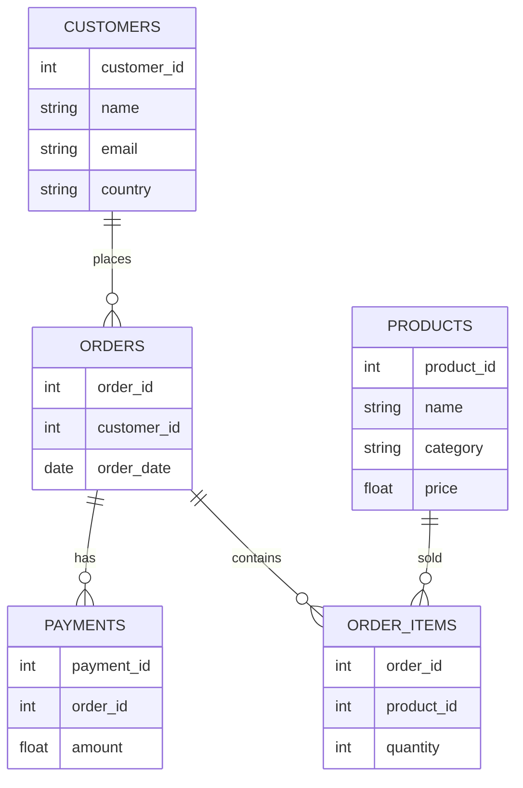

# 📊 Data Modeling Explained
## MSIS-2407 — Week 1

### From Data Usage → Data Design

---

# 🎯 Learning Objectives

By the end of this material you can:

---

# 🎯 Learning Objectives (cont.)

- Explain why data modeling matters before you build anything
- Distinguish structured, semi-structured, and unstructured data
- Identify entities, attributes (including composite, multi-valued, and derived),
  and relationships in a business scenario
- Define cardinality (1:1, 1:M, M:N) **and** participation (mandatory/optional,
  total/partial), and resolve many-to-many relationships with an associative entity
- Use primary keys, foreign keys, candidate keys, composite keys, and surrogate
  vs. natural keys correctly
- Read crow's-foot ER notation and interpret an ER diagram
- Extend ER to EER: model superclass/subclass specialization with disjoint vs.
  overlapping and total vs. partial constraints
- Recognize the most common relational and conceptual design mistakes
- Walk through a 7-step process for designing a relational database

---

# 🧠 The Big Transition

**MSIS-2402** taught:

👉 How to **query** data

**MSIS-2407** teaches:

👉 How to **design and manage** the data systems behind those queries

---

# 💼 Why This Matters

Bad database design leads to:

- inconsistent data
- duplication
- wrong analytics
- system failures

**Key question:** How should we *structure* data before storing it?

---

# 🏢 Where Databases Fit

Modern organizations manage many types of data — customer data, product data,
transaction data, operational data. A typical architecture:

```
Applications
     ↓
Database system
     ↓
Data storage
```

Databases give applications structured, reliable access to business data. Before
you create a single table, you design a **conceptual model** — most commonly using
**Entity-Relationship (ER) modeling**.

---

# 🧭 Structured, Semi-Structured, and Unstructured Data

Before you can model business data, you have to know **what kind of data you have**.
Most modeling techniques in this material apply cleanly to one of these three
categories and only partially to the others.

> **Catalog alignment.** The MSIS-2407 description names *"structured and
> unstructured data management"* as a course topic. These slides introduce it;
> **Part 3** (`data_modeling_03_structured_semistructured_unstructured.md`, with the
> demo notebook `data_modeling_03_demo_marimo.py`) is the full treatment — schema
> drift, design patterns, extraction, search, and governance.

---

# 🧭 The Three Categories

| | Structured | Semi-structured | Unstructured |
|---|---|---|---|
| **Schema** | fixed, defined **before** the data is written | travels **with** the data, varies per record | none |
| **Examples** | a `customers` table, a CSV with a stable header | JSON, XML, log events, Parquet with nested fields | email bodies, PDFs, images, audio, free-text notes |
| **Query with** | SQL | SQL with path expressions, or a document API | search, extraction, ML |

---

# 🧭 The Three Categories (cont.)

| | Structured | Semi-structured | Unstructured |
|---|---|---|---|
| **Typical store** | RDBMS | document store, data lake | object store, filesystem |
| **Share of enterprise data** | the minority | growing fast | the large majority |

---

# 🧭 The Three Categories (cont.)

Most organizations hold far more unstructured than structured data — and almost all
of their *governed, reportable* data is the structured minority.

---

# 🧭 What Each Category Looks Like in Practice

**Structured** — a row in an `orders` table:

| order_id | customer_id | order_date | status |
|---|---|---|---|
| 1042 | 87 | 2026-08-01 | shipped |

**Semi-structured** — the same shipment, as an event document:

```json
{
 "order_id": 1042, 
 "status": "shipped",
 "carrier": {"name": "UPS", "tracking": "1Z999AA1"}
}
```

**Unstructured** — a customer's free-text complaint about that same shipment:

---

# 🧭 What Each Category Looks Like in Practice (cont.)

> "The box for order #1042 arrived crushed on one corner and the tracking
> number on the label doesn't match what your confirmation email said. Can
> someone look into this?"

No fields to query directly — you can't `SELECT` "which complaints mention a
crushed box" without full-text search or extraction. What you *can* model is
the metadata around it:

| `doc_id` | `uri` | `media_type` | `related_order_id` |
|---|---|---|---|
| doc-8841 | s3://support/complaints/8841.txt | text/plain | 1042 |

The metadata row is structured even though the complaint text isn't — this is
the `document` table pattern shown a few slides ahead.

---

# ⚠️ The Boundary Is About Schema Commitment, Not File Format

A common misconception: "structured = database, unstructured = files." That is
wrong, and it will mislead you in design reviews. The real question is:
**when is the schema fixed?**

- **Schema-on-write** (structured) — schema enforced at insert time. A row that
  does not fit is *rejected*. You pay the cost up front and get guaranteed shape
  on read.
- **Schema-on-read** (semi/unstructured) — anything can be written; schema is
  imposed when someone queries. You defer the cost, and inherit the risk that two
  consumers impose *different* schemas on the same bytes.

A CSV file on disk is structured. A `JSON` column inside a relational table is
semi-structured. The container does not decide the category.

---

# 📝 Schema-on-Write: A Concrete Example

A bank's `transactions` table, with the schema fixed before any row exists:

```sql
CREATE TABLE transactions (
    transaction_id INTEGER PRIMARY KEY,
    account_id     INTEGER NOT NULL REFERENCES accounts(account_id),
    amount         NUMERIC(12,2) NOT NULL,
    txn_date       DATE NOT NULL,
    status         VARCHAR NOT NULL CHECK (status IN ('pending','posted','reversed'))
);

INSERT INTO transactions VALUES (9001, 501, 250.00, '2026-08-01', 'posted');
-- ✅ accepted: every column present, right type, status is a known value

INSERT INTO transactions VALUES (9002, 999, 250.00, '2026-08-01', 'posted');
-- ❌ rejected: account_id 999 doesn't exist in `accounts` (FK violation)

INSERT INTO transactions VALUES (9003, 501, NULL, '2026-08-01', 'pending');
-- ❌ rejected: amount is NOT NULL

INSERT INTO transactions VALUES (9004, 501, 40.00, '2026-08-01', 'in transit');
-- ❌ rejected: 'in transit' isn't in the allowed status list (CHECK violation)
```

The guarantee is enforced by the **database itself** — every application, script,
or analyst that ever writes to this table gets the same rules, whether they
remember to check or not. That is the price you pay up front for schema-on-write.

---

# 📝 Schema-on-Read: A Concrete Example

A clickstream log landing in a data lake as raw JSON, one event per line, with
**no schema check at write time**:

```json
{"event": "page_view", "user": "u123", "url": "/checkout", "ts": "2026-08-01T10:02:00Z"}
{"event": "page_view", "user": "u456", "url": "/home", "ts": "2026-08-01T10:02:05Z", "referrer": "google.com"}
{"event": "purchase", "user": "u123", "amount": 49.99, "ts": "2026-08-01T10:05:00Z"}
```

---

# 📝 Schema-on-Read: A Concrete Example (cont.)

All three lines were accepted, even though: the second event has an extra
`referrer` field the first doesn't, and the third (`purchase`) has no `url` at
all but does have an `amount` the other two lack. Nothing was rejected — the
schema is imposed later, by whoever writes the query:

```sql
SELECT payload->>'$.user' AS user_id, payload->>'$.amount' AS amount
FROM events
WHERE payload->>'$.event' = 'purchase';
```

**The risk:** an analyst who assumes every event has a `url` field will get
silent `NULL`s on `purchase` rows instead of an error — a different consumer
of the same bytes can impose a different, contradictory shape.

---

# 🏢 Why This Matters Commercially

A business question is usually answerable only if the data was **structured at the
right moment**.

| Question | Needs |
|---|---|
| "What was Q3 revenue by region?" | structured, schema-on-write, constraint-enforced |
| "Which contracts mention a liability cap?" | unstructured + extraction |
| "Which API errors spiked last night?" | semi-structured logs, schema-on-read |

The managerial decision is not *"which is better"* — it is **where in the pipeline
you commit to a schema**, and who bears the cost of that decision. Commit too early
and you cannot capture data you did not anticipate. Commit too late and every
consumer reinvents the interpretation, inconsistently.

---

# 🏗 The Modern Compromise: Layered Architectures

This is why the medallion pattern (Week 4) exists — it stages the commitment
rather than making it once:

```text
BRONZE   raw, as received          schema-on-read     nothing rejected
   ↓
SILVER   cleaned, typed, validated schema-on-write    rejects quarantined
   ↓
GOLD     modeled for consumption   schema-on-write    business definitions applied
```

Each layer moves data one step further toward schema commitment. Bronze keeps the
option to reinterpret; gold buys reliability by giving that option up. See
`datasets/medallion_architecture/` for a worked bronze/silver/gold example.

---

# 🔍 Modeling Implications

The ER modeling in this material assumes **structured** data. When the source is
not structured, one of three things has to happen first:

1. **Extract to structure.** Pull the fields you need into a relation
   (invoice PDFs → an `invoice` table). You model the extract, not the document.
2. **Store semi-structured, model the access path.** Keep the JSON, but declare
   which paths are contractual and index those. You are modeling an *interface*,
   not a schema.
3. **Leave it unstructured, model the metadata.** Keep the object in a store and
   model everything *about* it — owner, classification, retention, checksum.
   This is what Week 5's catalog work does.

Option 3 is the one people forget. You can govern data you have not structured.

---

# 🧪 In DuckDB — All Three, One Engine

DuckDB can hold all three categories, which makes the comparison concrete. Let's
look at each one on its own.

---

# 🧪 Structured Data in DuckDB

```sql
-- schema enforced at insert time — a bad row is rejected, not stored
CREATE TABLE customer (
    customer_id INTEGER PRIMARY KEY,
    name        VARCHAR NOT NULL
);

INSERT INTO customer VALUES (1, 'Ava Chen');
-- INSERT INTO customer VALUES ('x', 'Ava Chen');  -- ❌ rejected: wrong type for customer_id
```

The shape is guaranteed before you ever read the table back.

---

# 🧪 Semi-Structured Data in DuckDB

```sql
CREATE TABLE event (
    event_id INTEGER,
    payload  JSON,                       -- schema-on-read
    tags     VARCHAR[],                  -- LIST
    actor    STRUCT(id INTEGER, role VARCHAR)
);
```

- **`JSON`** — an arbitrary nested document; its shape is decided when you query it
- **`VARCHAR[]`** — a `LIST`, an ordered collection of values of the same type
- **`STRUCT(...)`** — a fixed-shape nested record, like a mini table inside a cell

---

# 🧪 Querying JSON in DuckDB

```sql
INSERT INTO event VALUES (
  1,
  '{"status": "shipped", "carrier": "UPS"}',
  ['promo', 'vip'],
  {'id': 9, 'role': 'agent'}
);

SELECT payload->>'$.status' AS status FROM event;
-- '$.status' is a JSONPath: $ = root of the document, .status = its "status" key
-- ->> extracts the value as text (VARCHAR); -> would extract it and keep it as JSON,
-- useful when chaining into a nested path instead of reading a final value

-- result:
--  status
-- ---------
--  shipped
```

---

# 🧪 Unstructured Data in DuckDB

```sql
-- model the metadata, not the bytes — the bytes live elsewhere (S3, filesystem)
CREATE TABLE document (
    doc_id       VARCHAR PRIMARY KEY,
    uri          VARCHAR NOT NULL,
    media_type   VARCHAR NOT NULL,
    sha256       VARCHAR NOT NULL,
    retain_until DATE
);
```

You cannot query *inside* the PDF or image from SQL — but you can govern who owns
it, how long to keep it, and whether it changed (`sha256`).

Week 4 Part 2 and Session 8's Lab 2b take this much further.

---

# 🧠 What Is Data Modeling?

A process to represent real-world systems using data structures — a visual
blueprint for how an organization collects, stores, relates to, and accesses its
data. Just like an architect's blueprint before building a house, a data model
provides the foundational structure needed for a database to be efficient,
accurate, and aligned with actual business requirements.

---

# 🧠 What Is Data Modeling? (cont.)

**Relational data modeling** specifically translates real-world business
requirements into a structured database schema:

- Entities → Tables
- Attributes → Columns
- Relationships → Keys

It remains the foundation of DuckDB, PostgreSQL, MySQL, SQLite, SQL Server, and
Oracle because it reduces ambiguity about where data should live, makes validation
explicit, keeps queries predictable, and makes change safer as the application grows.

---

# 🧠 The Data Modeling Process

Building a relational model happens in four distinct, iterative phases. The next
four slides walk through the *same* e-commerce example, one phase at a time.

1. **Requirements gathering**
2. **Conceptual model**
3. **Logical model**
4. **Physical model**

---

# 1️⃣ Requirements Gathering

List the real-world objects and rules you need to track, in plain English:

- "A customer can place many orders."
- "An order must belong to exactly one customer."
- "An order can contain many products, and a product can appear on many orders."
- "Every order has a date and a status."

No tables, no columns yet — just the business facts you must not contradict later.

---

# 2️⃣ Conceptual Model

Identify core entities (the nouns) and their high-level relationships — still no
technical detail:

```
Customer ───places───< Order >───contains───< Product
```

**Entities:** Customer, Order, Product
**Relationships:** Customer *places* Order (1:M) · Order *contains* Product (M:N)

---

# 3️⃣ Logical Model

Convert entities into tables, assign attributes to columns, and mark keys — still
no DBMS-specific types:

```
Customer            Order                  Product
-----------         -----------            -----------
customer_id PK      order_id PK            product_id PK
name                customer_id FK         name
email               order_date             price
                    status
```

The Order↔Product many-to-many relationship still needs a bridge table — covered
later in this deck, once keys have been introduced.

---

# 4️⃣ Physical Model

Tailor the logical model to a specific DBMS — real types, constraints, indexes:

```sql
CREATE TABLE customer (
    customer_id INTEGER PRIMARY KEY,
    name        VARCHAR NOT NULL,
    email       VARCHAR NOT NULL UNIQUE
);

CREATE INDEX idx_customer_email ON customer(email);
```

The logical model says "email is unique"; the physical model says *how* DuckDB
enforces and indexes that. Exact types and index choices are DBMS-specific — this
is why Week 3 (Database Implementation) exists.

---

# 📦 Entities and Attributes

An **entity** is a real-world object worth tracking on its own. An **attribute**
describes that entity.

**Example — e-commerce**

| Entity | Attributes |
|---|---|
| Customer | `customer_id`, `name`, `email` |
| Product | `product_id`, `name`, `category`, `price` |
| Order | `order_id`, `customer_id`, `order_date` |

Keep attributes **atomic**, **consistently named**, **typed**, and belonging to the
entity they actually describe — `product_name` belongs to Product, not Order.

---

# 📦 A Second Example: Netflix

Same exercise, different domain — try it yourself before reading the answer:

| Entity | Attributes |
|---|---|
| Viewer | `viewer_id`, `name`, `plan` |
| Show | `show_id`, `title`, `genre` |
| WatchEvent | `viewer_id` (FK), `show_id` (FK), `watched_at`, `minutes_watched` |

`WatchEvent` plays the same role here that `order_items` plays for e-commerce: it
connects two entities that have a many-to-many relationship (a Viewer watches many
Shows; a Show is watched by many Viewers).

---

# 🏷 Attribute Types

Not every attribute is a single, simple value. Classic ER vocabulary distinguishes:

---

# 🏷 Attribute Types (cont.)

- **Simple** — cannot be split further: `price`, `order_date`
- **Composite** — made of parts you might store together or split: `address` →
  `street`, `city`, `zip`
- **Single-valued** — one value per entity instance: `birth_date`
- **Multi-valued** — an entity can have several at once: a Customer's
  `phone_numbers` → this gets its **own table**, one row per phone number, never
  a comma-separated list
- **Derived** — computed from other data, not stored: `age` from `birth_date`, or
  an order's `total` from summing its `order_items`
- **Key attribute** — the one (or set) that identifies the entity: `customer_id`

A multi-valued attribute is exactly why "storing lists in one column" (a common
mistake, covered ahead) is a design smell — it wants to become its own table.

---

# 🔒 Domains and Constraints

A **domain** defines the allowed values of an attribute — in practice, a data type
plus validation rules, enumerations, ranges, or constraints.

- `email` should be text with a uniqueness rule
- `order_date` should be a date
- `quantity` might be restricted to positive integers

Constraints enforce this at the database level:

`PRIMARY KEY` · `FOREIGN KEY` · `UNIQUE` · `NOT NULL` · `CHECK`

A model is not only about drawing tables — it is also about expressing the rules
that must always remain true.

---

# 🔗 Relationships

Entities are connected. In our example:

- Customer → Order (a customer places orders)
- Order → Product (an order contains products)

**Discussion:** What are the entities in Uber? In Netflix?

---

# 🧠 Cardinality

Cardinality defines the *size* of a relationship between two entities. There are
three shapes; the next three slides give each one a worked example.

- **One-to-One (1:1)**
- **One-to-Many (1:M)**
- **Many-to-Many (M:N)**

---

# 🔗 One-to-One (1:1)

One row on each side relates to **exactly one** row on the other side.

```
User ↔ Profile — one user has exactly one profile

users(user_id PK, email)
profiles(user_id PK FK -> users, bio, avatar_url)
```

Notice `profiles.user_id` is *both* the primary key and the foreign key — that is
what forces the relationship to be 1:1 instead of 1:M.

---

# 🔗 One-to-Many (1:M)

The most common shape: one row on the "one" side relates to many rows on the
"many" side.

```
Customer → Order — one customer, many orders

customers(customer_id PK, name)
orders(order_id PK, customer_id FK -> customers, order_date)
```

The foreign key always lives on the **many** side — `orders.customer_id`, not the
other way around.

---

# 🔥 Many-to-Many (M:N)

Rows on **both** sides can relate to multiple rows on the other side.

```
Order ↔ Product — many orders, many products

One order contains many products.
One product appears on many orders.
```

This cannot be expressed with a single foreign key on either table. It needs a
**bridge (junction) table** — covered once keys have been introduced, later in
this deck.

---

# 🎯 Participation: Mandatory vs. Optional

Cardinality answers *"one or many?"* — **participation** answers a different
question: *does every instance have to take part in the relationship at all?*

- **Mandatory (total participation)** — every row of this entity **must** have
  at least one link. Example: every Order must belong to a Customer — an order
  cannot exist in a vacuum.
- **Optional (partial participation)** — a row is allowed to have **zero**
  links. Example: a Customer can exist with zero Orders — someone can register
  without ever buying anything.

Cardinality and participation are **independent** — you need both to fully
describe one end of a relationship, and they are separate questions in every
modeling exercise.

---

# 🧭 Crow's-Foot Notation: Cardinality + Participation Together

Each end of a relationship line carries one symbol, combining both ideas:

```
ONE,  mandatory:  ──┤├──   "exactly one"
ONE,  optional:   ──○├──   "zero or one"
MANY, mandatory:  ──┤<──   "one or more"
MANY, optional:   ──○<──   "zero or more"
```

The **crow's foot** (three-pronged fork) means *many*; a **bar** near the entity
means *mandatory*; a **circle** near the entity means *optional*. The symbol
always sits on the end **closest to the entity it describes**:

---

# 🧭 Crow's-Foot Notation: Cardinality + Participation Together (cont.)

```
Customer ──┤├───────○<── Order
```

Read in two halves: the end touching `Customer` (`┤├`, one/mandatory) describes
*Order's* view — "each Order relates to exactly one Customer." The end touching
`Order` (`○<`, many/optional) describes *Customer's* view — "each Customer
relates to zero-or-more Orders." Full reference: `ERD_Notation_Guide.md`.

---

# 🔑 Primary Key (PK)

A column, or set of columns, that **uniquely identifies a row**. A primary key
must be **unique**, **NOT NULL**, and **stable**.

```sql
CREATE TABLE customers (
  customer_id INTEGER PRIMARY KEY,
  name        TEXT NOT NULL,
  email       TEXT NOT NULL UNIQUE
);
```

❌ **Bad primary keys:** `name`, `email` (can change) — an unstable identifier
makes every dependent relationship harder to manage as the value changes.

---

# 🔗 Foreign Key (FK)

A column that **links two tables** together — it means "this row belongs to a row
in another table."

```sql
CREATE TABLE orders (
  order_id    INTEGER PRIMARY KEY,
  customer_id INTEGER NOT NULL,       -- FK
  order_date  DATE NOT NULL,
  FOREIGN KEY (customer_id) REFERENCES customers(customer_id)
);
```

| Concept | Purpose |
|---|---|
| PK | identify a row |
| FK | connect tables |

---

# 🔑 Candidate Key

A **candidate key** is any minimal set of columns that could uniquely identify a
row. One of them is chosen as the primary key; the others can still be protected
with a `UNIQUE` constraint.

Example: in `customers`, both `customer_id` and `email` could uniquely identify a
row. `customer_id` is chosen as the primary key because it is stable; `email` is
still enforced as `UNIQUE` because it is a candidate key.

---

# 🔑 Surrogate Key vs. Natural Key

- **Natural key** — an identifier that already exists in the business data:
  `email`, `isbn`, `ssn`. Meaningful to humans, but risky as a PK if it can
  change or isn't guaranteed unique.
- **Surrogate key** — an artificial identifier with no business meaning, created
  solely to identify the row: an auto-incrementing `customer_id`, or a UUID. It
  never changes, because nothing about the business can force it to.

**Rule of thumb:** when a candidate key isn't guaranteed stable — names, emails,
codes that could be reassigned — introduce a surrogate key and keep the natural
key as a `UNIQUE` candidate key instead of the PK.

---

# 🔥 Many-to-Many → Bridge Table

An Order can contain many Products, and a Product can appear in many Orders — this
cannot be stored directly with a single foreign key on either side.

**Solution:** introduce a bridge (junction) table that turns one M:N relationship
into two 1:M relationships.

```sql
CREATE TABLE order_items (
  order_id   INTEGER NOT NULL,
  product_id INTEGER NOT NULL,
  quantity   INTEGER NOT NULL,
  PRIMARY KEY (order_id, product_id),
  FOREIGN KEY (order_id)   REFERENCES orders(order_id),
  FOREIGN KEY (product_id) REFERENCES products(product_id)
);
```

This pattern (bridge table with two FKs) is used everywhere: e-commerce, banking,
healthcare, course enrollment systems.

---

# 🔑 Composite Primary Key

A **composite (compound) primary key** uses more than one column *together* to
uniquely identify a row — exactly what `order_items` needed above:

```sql
PRIMARY KEY (order_id, product_id)
```

Neither `order_id` alone nor `product_id` alone is unique in this table (an order
has many items; a product appears in many orders) — but the **pair** is: one row
per product, per order.

---

# 🔗 Associative Entities: When a Relationship Has Its Own Data

`order_items` looks like a plain bridge table, but look closer: it holds
`quantity`, a fact that belongs to neither Order alone nor Product alone — it
belongs to *that specific pairing*. Whenever a relationship carries its own data,
it gets promoted from a line on the diagram to its own entity.

```
Order 1───< OrderItem >───1 Product
                │
             + quantity
```

This is the general pattern behind every bridge table you'll build: the M:N
cardinality forces a junction table to exist at all; **attributes on the
relationship** decide what columns live inside it. Asking which entity a
fact like `seats` belongs to is this exact idea.

---

# 🔁 Self-Referencing Relationships

Sometimes an entity relates to **itself**. Example: a product `category` can have
a parent category (Electronics → Laptops → Gaming Laptops).

```
Category 1───< Category     (parent / child)
```

```sql
CREATE TABLE category (
    category_id         INTEGER PRIMARY KEY,
    name                VARCHAR NOT NULL,
    parent_category_id  INTEGER REFERENCES category(category_id)
);
```

Drawn as a loop back to the same box on an ER diagram; implemented as a foreign
key column that references its **own** table's primary key. Other examples: an
Employee's manager is also an Employee; a Comment can reply to another Comment.

---

# 🔁 Querying a Hierarchy: Recursive CTEs

A self-referencing table stores a **tree**. "Show every category with its full
path" needs a query that follows `parent_category_id` as deep as it goes —
a **recursive CTE**:

```sql
WITH RECURSIVE tree AS (
    -- 1. anchor: the top-level categories
    SELECT category_id, name, 0 AS depth, name AS path
    FROM category
    WHERE parent_category_id IS NULL
    UNION ALL
    -- 2. recursive step: children of rows already found
    SELECT c.category_id, c.name, t.depth + 1, t.path || ' > ' || c.name
    FROM category AS c
    JOIN tree AS t ON c.parent_category_id = t.category_id
)
SELECT category_id, depth, path FROM tree ORDER BY path;
```

---

# 🔁 Recursive CTE — Result and How It Runs

| category_id | depth | path |
|---:|---:|---|
| 1 | 0 | Electronics |
| 2 | 1 | Electronics > Computers |
| 3 | 2 | Electronics > Computers > Laptops |
| 4 | 3 | Electronics > Computers > Laptops > Gaming Laptops |
| 5 | 1 | Electronics > Phones |
| 6 | 0 | Home |
| 7 | 1 | Home > Kitchen |

The anchor runs once; the recursive step runs again and again on the rows the
previous round produced, until a round finds **no new rows**.

---

# ⚠️ Cycles: When the Tree Isn't a Tree

A data-entry error can make a category its own ancestor
(Computers → Gaming Laptops → Laptops → Computers → …). The recursive step then
**always** finds new rows, and the query never returns — no error, no answer.

The fix: carry the **path visited so far** as a list, and refuse to step onto a
node already in it:

```sql
-- inside the recursive step
WHERE NOT list_contains(visited, next_id)   -- stop on revisit: the real fix
  AND len(visited) < 50                      -- depth cap: only a safety net
```

`[x]` builds a DuckDB list, `list_append(l, x)` extends it, and
`list_contains(l, x)` tests membership. A depth cap alone hides the cycle
instead of finding it.

---

# 🧭 Mermaid ER Notation (Diagrams-as-Code)

The hand-drawn crow's-foot notation you just learned (`┤├`, `○<`, ...) has an
equivalent when diagrams are written as code, e.g. in Mermaid (used on the next
slide) or many modeling tools:

| Mermaid symbol | Meaning | Same as |
|---|---|---|
| <code>&#124;&#124;</code> | exactly one | `┤├` |
| <code>o&#124;</code> | zero or one | `○├` |
| <code>&#124;{</code> | one or many | `┤<` |
| `o{` | zero or many (the "crow's foot") | `○<` |

`CUSTOMERS ||--o{ ORDERS : places` reads exactly like the ASCII version: **"one
customer relates to zero-or-many orders."** Same concepts, different syntax —
pick whichever your tool supports.

---

# 🧠 Full ER Diagram Example

**Online Marketplace** — Customers, Products, Orders, Payments, Order_Items

---

# 🧠 Full ER Diagram Example (cont.)



---

# 🧬 Beyond ER: What Is EER?

Plain ER modeling struggles with one common business shape: *"this entity is
really several different kinds of the same thing."* The **Enhanced/Extended ER
(EER) model** adds one new concept to handle it: a **superclass/subclass**
relationship — the same idea as inheritance in object-oriented design.

- **Superclass** — the general entity, holding attributes shared by all kinds
- **Subclass** — a specialized kind of the superclass, holding attributes that
  only *that* kind has
- Every subclass **inherits** the superclass's attributes and its identifier

This is the "EER diagrams" half of the Week 1 topic list, and Session 2's Lab 2b
practises it.

---

# 🧬 Specialization vs. Generalization

Two directions to reach the same superclass/subclass structure:

- **Specialization (top-down)** — you start with one entity and split it because
  different instances behave differently. Example: start with `Payment`, notice
  that card payments and bank-transfer payments need different attributes, and
  split it.
- **Generalization (bottom-up)** — you start with several entities that already
  look similar and factor out their shared attributes into a new superclass.
  Example: you already have `CardPayment` and `BankTransferPayment` tables, and
  pull `payment_id`, `order_id`, `amount` up into a shared `Payment`.

Same diagram either way — only the direction you *arrived* at it differs.

---

# 🧬 Worked Example: Payment Specialization

`Payment` splits into two kinds, each with attributes the other doesn't have:

```
                 PAYMENT
          payment_id, order_id, amount
                    │
                    ○  (disjoint, total)
          ┌─────────┴─────────┐
     CARD_PAYMENT        BANK_TRANSFER_PAYMENT
     card_last4          bank_name
     auth_code           iban
```

- `CARD_PAYMENT` and `BANK_TRANSFER_PAYMENT` each inherit `payment_id`,
  `order_id`, `amount` from `Payment`, and add their own attributes on top.

---

# 🧬 Disjoint/Overlapping and Total/Partial

Two constraints describe *how* a superclass splits into subclasses — the same
graded checklist as cardinality + participation:

- **Disjoint (d)** — an instance can belong to **only one** subclass. A payment
  is either a card payment *or* a bank transfer, never both.
- **Overlapping (o)** — an instance **can** belong to more than one subclass at
  once. Example: `Person` → `Employee` and `Customer` — someone can be both.

- **Total** — **every** superclass instance must belong to some subclass. Every
  `Payment` is one of the two kinds; there is no third, unclassified kind.
- **Partial** — a superclass instance is **allowed** to belong to no subclass.

**This example:** disjoint (a payment method is exactly one kind) and total
(every payment must be classified as one or the other).

---

# ❌ Common Design Mistakes (1 of 3)

1. **One big table** — `customer, order, product, price, quantity` all mixed
   together → duplication, update anomalies

2. **Missing or unstable keys** — no primary key, or using `name`/`email` as the
   only identifier → cannot reliably identify or track a row over time

3. **Ignoring or misjudging cardinality** — wrong relationship type chosen up
   front → wrong analytics later, inconsistent implementation

---

# ❌ Common Design Mistakes (2 of 3)

4. **Data redundancy** — the same fact (e.g., product price) repeated everywhere
   → inconsistent updates when it changes

5. **Storing lists in one column** — `"SQL, Python, Java"` in a single field
   usually means the design should be split into a bridge table

6. **Designing from SQL syntax instead of business rules** — good schemas start
   from the domain, not from whatever query happened to be needed first

---

# ❌ Common Design Mistakes (3 of 3)

7. **Drawing attributes as entities** — `Email` is not its own box on the
   diagram; it's a property of `Customer`. A box earns its place only if it has
   its own identifier and its own attributes beyond the one you started with.

8. **Giving cardinality but skipping participation** — "1:M" alone doesn't say
   whether the "one" side is mandatory or optional. Both are graded separately;
   both are required to fully describe a relationship.

---

# 🔍 Case Study: The Duplicated Price

`orders_flat` (one big table, mistakes #1 and #4 at once):

| order_id | product_name | price |
|---|---|---|
| 1001 | Widget | 19.99 |
| 1002 | Widget | 19.99 |
| 1003 | Widget | 19.99 |

The Widget's price rises to $24.99. **How many rows need to change?** Every row
that mentions "Widget" — miss even one, and reports disagree with reality.

**Fix:** store the price once, in `products`, and reference it by `product_id`.
Every order that references that product then sees the new price automatically.

---

# 🧪 Bad Design → Good Design

**Fix this:**

```
order_id, customer_name, product_name, price
```

**Into:**

- `customers` (customer_id, name, email)
- `products` (product_id, name, price)
- `orders` (order_id, customer_id, order_date)
- `order_items` (order_id, product_id, quantity)

This separation removes duplication and makes updates safe — change a product's
price once, and every order that references it sees the new value.

---

# 🧪 A Second Worked Example: Library

**Fix this:**

```
loan_id, member_name, member_email, book_title, book_isbn, due_date
```

**Into:**

- `members` (member_id, name, email)
- `books` (isbn, title)
- `loans` (loan_id, member_id, isbn, due_date)

Same shape as the e-commerce fix: one flat table was hiding **three entities**
(Member, Book, Loan) and the relationships between them. Once you can see the flat
table this way, the split is mechanical.

---

# 🔎 A Preview of Normalization

**Normalization** is the process of organizing data to reduce redundancy and
improve integrity, typically by dividing large tables into smaller related ones.
The most common forms (full detail in **Week 2**):

- **1NF** — every column holds atomic, single-valued, single-typed data
- **2NF** — meets 1NF; every non-key attribute depends on the *whole* primary key
- **3NF** — meets 2NF; removes transitive dependencies (non-key attributes depend
  only on the key, not on other non-key attributes)

The relational **model** defines structure and rules; **normalization** improves
that structure by removing redundancy and dependency anomalies. Related but not
identical.

---

# 🛠 How to Design a Relational Database — 7 Steps

1. **Gather requirements** — list the real things to track and the business rules
2. **Identify entities** — repeated nouns in the requirements are candidates
3. **Identify attributes** — properties that belong to one entity, and only one
4. **Define keys** — choose primary keys; note other candidate/unique keys
5. **Define relationships** — map 1:1, 1:M, and M:N explicitly
6. **Normalize the schema** — check for redundancy and dependency problems
   (Week 2)
7. **Add indexes only after query patterns emerge** — schema first, access-path
   tuning second (Week 3)

---

# 💬 Discussion & In-Class Exercises

- What are the entities in Uber? In Netflix?
- **Exercise:** Design an ER diagram for an online bookstore. Include Customer,
  Book, and Order, plus a bridge table if needed. Mark cardinality **and**
  participation on every relationship.
- **Exercise:** Design an ER diagram for an online marketplace: Customers,
  Products, Orders, Payments.
- **Exercise (EER):** A `Vehicle` entity needs to split into `Car` and `Truck`,
  each with different attributes. Is the split disjoint or overlapping? Total or
  partial? Sketch the specialization.

---

# ✅ Check Your Understanding

1. A vendor sends a daily CSV whose column order changes without warning. Is that
   structured data? What actually broke — the category, or the contract?
2. Your team stores customer support emails in S3 and a table of
   `(email_id, uri, received_at, customer_id)` in the warehouse. Which of the three
   modeling implications above is that, and what can you now report on?
3. Give one business question your organization *cannot* answer because someone
   committed to a schema too early, and one it cannot answer because someone
   committed too late.

---

# ❓ FAQ

**What is a relational data model in a DBMS?**
The logical framework that represents data as related tables with keys,
constraints, and well-defined relationships.

**Relational model vs. relational database?**
The model is the theory/design approach; the database is the actual implemented
system stored and managed by a DBMS.

**A simple example?**
A shop database with `customers`, `orders`, `products`, and `order_items` — each
table stores one subject, and foreign keys connect them.

**Why does the relational model still matter?**
It remains the clearest, most reliable way to manage structured data across
transactional and analytics systems.

---

# 🧠 What Did We Learn?

- Entities, attributes (simple/composite, single/multi-valued, derived), and
  relationships
- Cardinality **and** participation — two independent, both-required properties
  of a relationship
- Primary, foreign, candidate, composite, and surrogate keys
- Many-to-many relationships, bridge tables, and associative entities
- Self-referencing relationships, and querying them with recursive CTEs
- EER: specialization/generalization, disjoint/overlapping, total/partial
- Common design mistakes and how to avoid them
- A repeatable process for going from requirements → working schema

**Key insight:** Good database design prevents future problems — good analytics
depends on good data design.

---

# 🚀 Next: Week 2

- Relational schema, formalized
- Normalization: 1NF → 2NF → 3NF → BCNF
- Removing redundancy systematically

---

# 🙌 End of Data Modeling Explained
